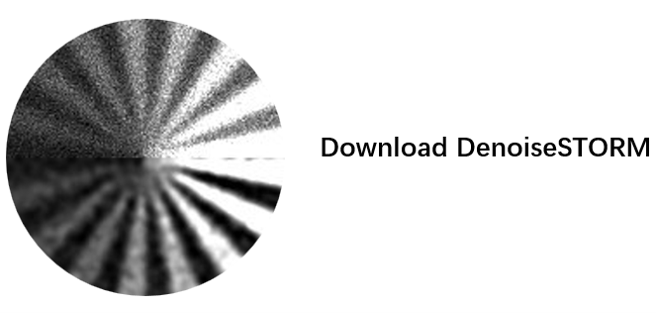

## Links

- [Releases]()

  

## About DenoiseSTORM

DenoiseSTORM is an open-source, interactive, and modular plug-in for [Fiji(ImageJ)](https://imagej.net/software/fiji/downloads) designed for automated dehazing, denoising, and deconvolution of 2D grayscale images acquired by sCMOS, CCD, and EMCCD cameras. Our philosophy in developing DenoiseSTORM has been to offer an extensive collection of processing algorithms so that users can easily process and analyze their data.

## Getting started

Install [Fiji(ImageJ)](http://imagej.nih.gov/ij/index.html) and download the latest version of [DenoiseSTORM](https://github.com/iljgl/DenoisePlugin/releases/latest). For installation, copy the downloaded file into ImageJ's plugin subdirectory and run ImageJ. The algorithm is located in process->DenoiseStorm.See the [Installation guide]() for more information. To get started using DenoiseSTORM, see the [Tutorials](). Example data are provided [here]().

## How to cite DenoiseSTORM

If you use ThunderSTORM to process your data, please, cite our [paper]():

xxxxxx.
